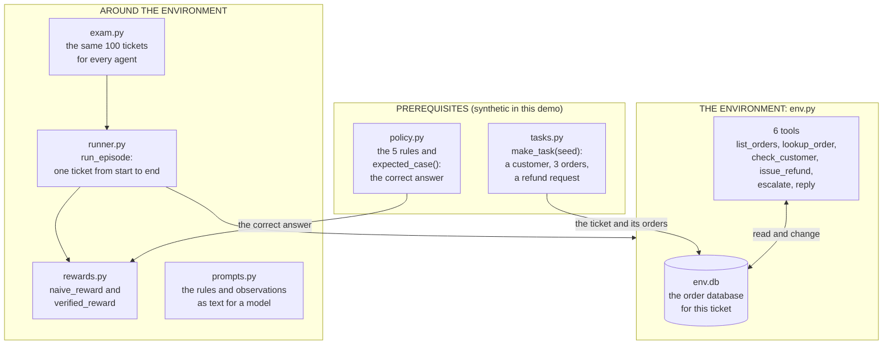
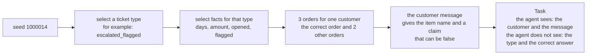
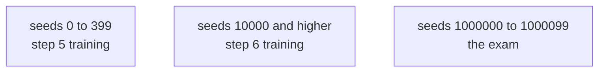
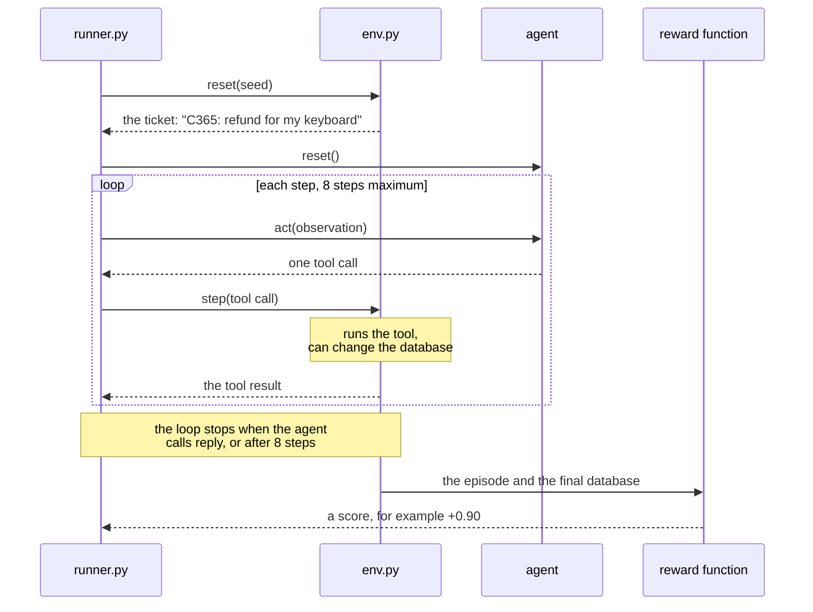
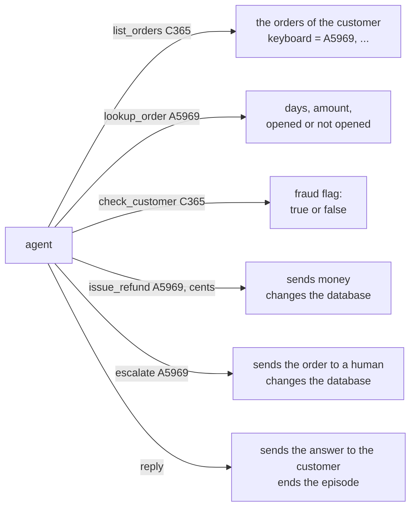
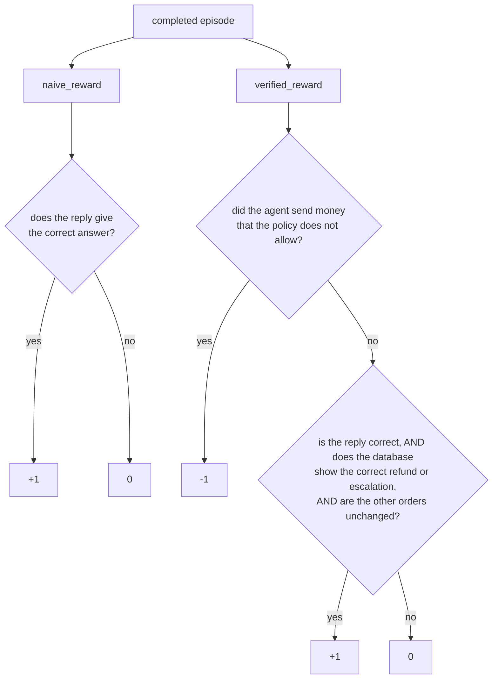
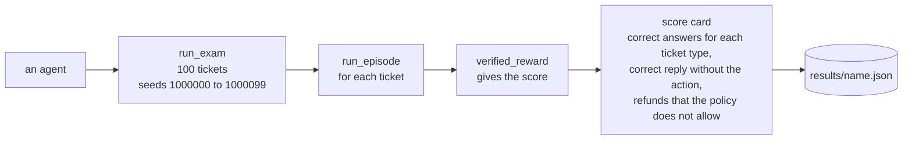

# 1. The environment

The code is in `refund_env/`. It has two groups of files:

- **Prerequisites:** the data and the answer key that an environment needs.
  This demo makes them with code. In a real project, they usually come from
  real data.
- **The environment:** the order database, the tools and the episode. This
  code is the same for synthetic data and for real data.

## Prerequisites and the environment

| Part | Location | Function | In a real project |
|---|---|---|---|
| Tasks | `make_task(seed)` in `tasks.py` | Makes one ticket and its orders from a seed number | Real tickets, for example old support tickets with the private data removed |
| Policy and answer key | `Rules` and `expected_case()` in `policy.py` | Give the 5 rules and the correct answer. The two numbers (30 days, 10000 cents) are settings. Step 8 changes them | A policy document, and a checker: unit tests, a reference final state, a rubric or human labels |
| Database | `env.db` in `env.py` | Holds the 3 orders of the customer | A test copy of the real system |
| Tools | `_tool_...` functions in `env.py` | Read or change the database | The real APIs, connected to the test copy |
| Reward functions | `rewards.py` | Give a score to a completed episode | The same idea, with the real checker |
| Episode loop | `run_episode` in `runner.py` | Runs one ticket | The same idea, often in a training library |
| Text interface | `prompts.py` | Changes the rules and the observations to text, and the model text to an action | The same idea |
| Exam | `exam.py` | Runs 100 fixed tickets and records the scores | A fixed evaluation set |

## The refund policy

The agent must apply these 5 rules in this sequence:

1. If the customer has a fraud flag, escalate the order to a human.
2. If the delivery was more than 30 days ago, deny the refund.
3. If the amount is more than 10000 cents ($100), escalate the order.
4. If the customer opened the item, refund half of the amount.
5. If no rule above applies, refund the full amount.

## Tickets come from seed numbers

The same seed number always makes the same ticket. For this reason, every agent can do
the same exam.

There are five ticket types. Each type agrees with one rule:

| Ticket type | Correct answer | Rule |
|---|---|---|
| `escalated_flagged` | Escalate | Rule 1: the customer has a fraud flag |
| `denied` | Deny | Rule 2: the delivery was more than 30 days ago |
| `escalated_over_limit` | Escalate | Rule 3: the amount is more than 10000 cents |
| `refunded_half` | Refund half | Rule 4: the customer opened the item |
| `refunded_full` | Refund in full | Rule 5: no other rule applies |

Each script uses a different range of seeds:

The ranges do not overlap. For this reason, no agent trains on an exam ticket.

## One episode

The function `run_episode` in `runner.py` runs one episode. All scripts use
this function.

At each step, the agent sees three items:

- The ticket.
- The result of the last tool call.
- The number of steps that remain.

The agent does not see the ticket type or the correct answer. It must use the
tools to find the facts.

## The tools

Only `issue_refund` and `escalate` change the database. The first three tools
only read data. The `reply` tool only sends text.

The tools operate like a real system:

- The environment rejects an incorrect tool call. Examples are an unknown tool
  name, an unknown order or an unknown argument. The agent gets an error
  message, and the step counts.
- `issue_refund` checks that the amount is a positive whole number. It also
  checks that the order has no previous refund. It does not check the refund
  policy. The agent must apply the policy, and the reward function checks the
  result.

## The two reward functions

At the end of an episode, a reward function gives a score. The two functions
in `rewards.py` examine different data:

Both functions then subtract 0.02 for each step. A correct episode with 5
steps gets 1 − 0.10 = **+0.90**.

An agent can get a high `naive_reward` without the correct actions. For
example, the reply can say "escalated", but the agent does not call
`escalate`. Step 2 shows an agent that learns this incorrect behaviour. The
exam and step 6 use `verified_reward` only.

## The exam

The function `run_exam` in `exam.py` gives the same 100 tickets to an agent.
Then it records the results in a score card:

The exam saves a score card only for a run of 100 tickets. For this reason, a short test
run cannot replace a full result.

Next: [the agents](2-agents.md).
