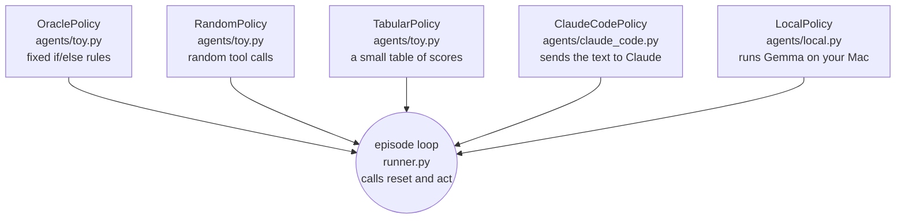
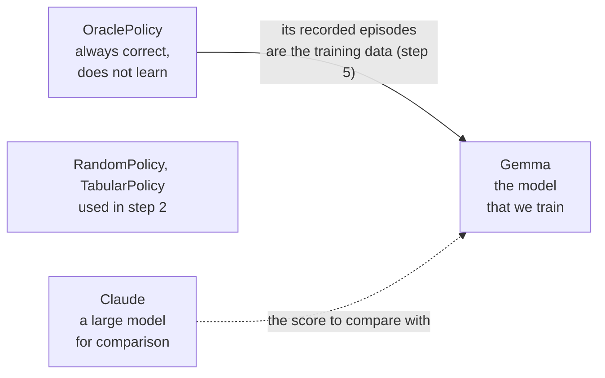
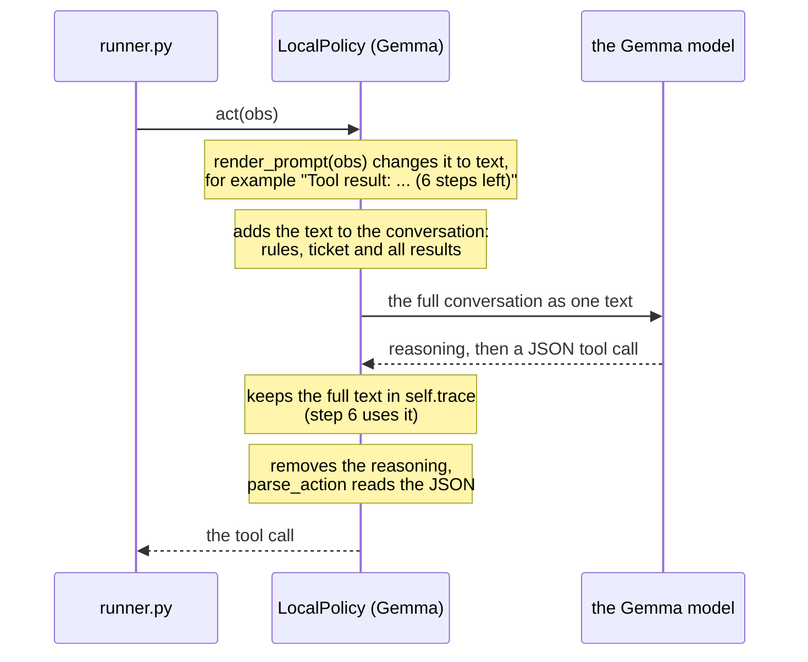
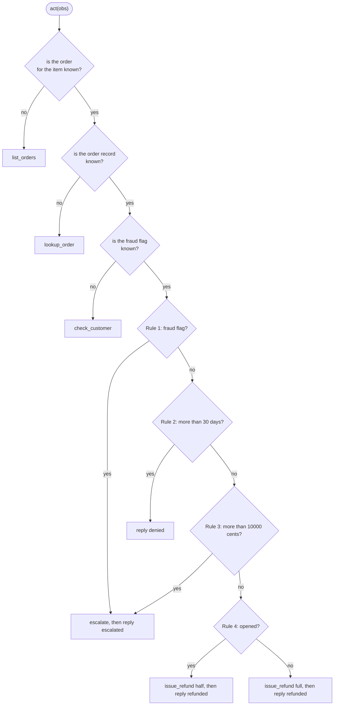

# 2. The agents

An agent is a program or a model that selects the tool calls for a ticket. The
agents are in `agents/`.

## One interface for all agents

The episode loop (`runner.py`) calls only two methods on an agent:

```python
agent.reset()            # a new ticket starts
action = agent.act(obs)  # the agent receives the observation and returns one tool call
```

The return value is always one tool call, for example
`{"tool": "lookup_order", "args": {"order_id": "A5969"}}`.

Each agent class has these two methods. The episode loop does not know how an
agent selects its tool call:



Because of this interface, the environment, the reward functions and the exam
operate with every agent without changes. You can compare the scores
directly. Each agent gets the same tickets, the same rules and the same
reward function.

## The function of each agent



| Agent | Function | Steps |
|---|---|---|
| `OraclePolicy` | Shows that a score of 100% is possible. Its recorded episodes are the training data for step 5 | 1, 2, 5 |
| `RandomPolicy` | Gives the lowest score, for comparison | 2 |
| `TabularPolicy` | A small program that learns from scores. It shows what each reward function teaches | 2 |
| `ClaudeCodePolicy` | Claude, a large model. Its score is the target | 3 |
| Gemma | The small model on your Mac. We test it and train it | 4, 5, 6, 8 |

## How a language model operates as an agent

Claude and Gemma read text and write text. They do not use Python
dictionaries. Their agent classes change the data in the two directions:



Claude uses the same procedure. `ClaudeCodePolicy` sends the conversation
through the Claude Code command-line tool. The tool uses your login, so you do
not need an API key.

Sometimes a model writes text that is not valid JSON. Then `parse_action`
sends the text to the environment without changes. The environment rejects it
as an incorrect tool call. The episode loop does not stop. The agent only
loses one step.

## How the expert selects a tool call

`OraclePolicy` in `agents/toy.py` is plain Python code. It keeps a record of
the tool results. At each step, it finds the first fact that it does not know:



For each tool call, the expert also writes one sentence of reasoning. The
sentence contains the real numbers from the order. An example is: *"Rule 1:
the customer is not flagged. Rule 2: delivered 6 days ago, within 30."* The
expert keeps the sentence in `self.thought`. Step 5 records it as the
reasoning that Gemma learns.

The expert is also a prerequisite. It is possible only because the rules
are exact. In a real project, the examples usually come from logs of human
agents or from a larger model.

Next: [the steps](3-steps.md).
