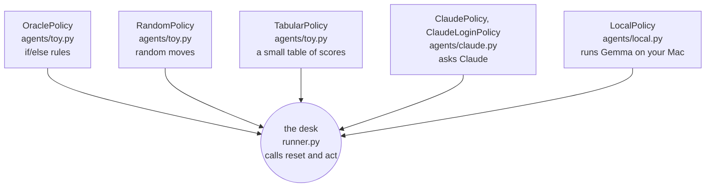
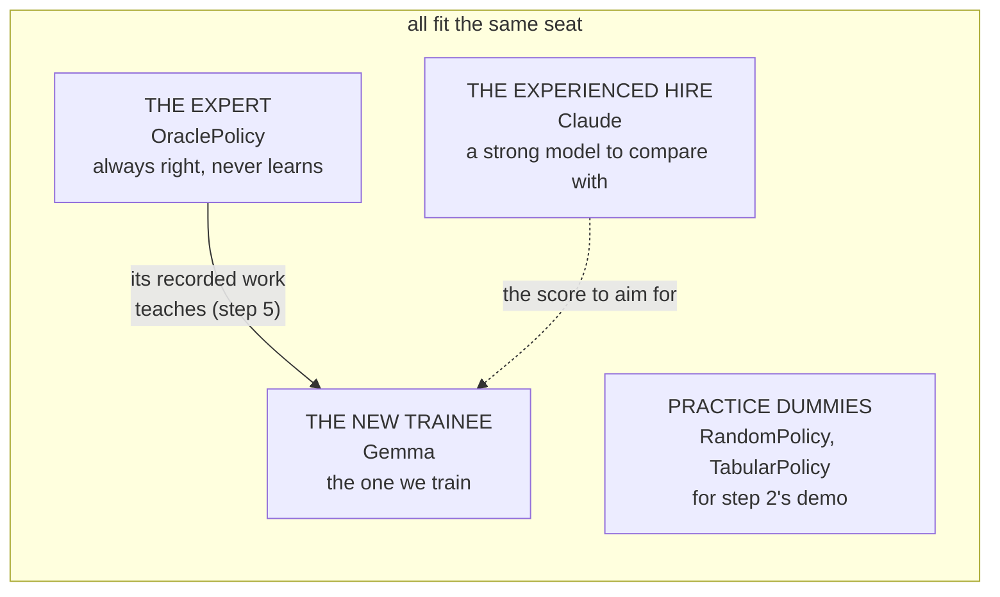
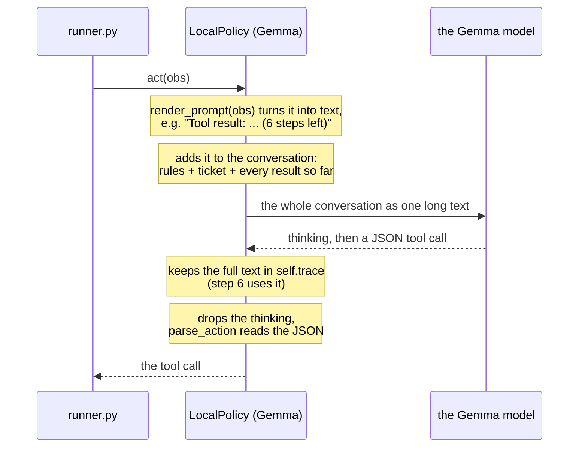
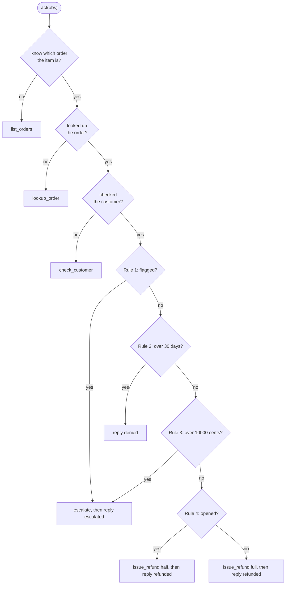

# 2. The trainees

A trainee is anything that can sit at the desk and work a ticket. They live in
`agents/`.

## One seat, many trainees

The desk (`runner.py`) asks a trainee only two things:

```python
trainee.reset()            # a new ticket is starting
action = trainee.act(obs)  # here is what you can see; what's your next tool call?
```

The answer is always a tool call like
`{"tool": "lookup_order", "args": {"order_id": "A5969"}}`.

Anything that answers those two questions fits the seat. The desk never asks
**how** the answer was made:



Because they all fit the same seat, the shop, the managers and the exam work
with every one of them, unchanged. The scores are directly comparable: the same
tickets, the same rules, the same manager.

## Same seat, different jobs



| Trainee | Job | Used in |
|---|---|---|
| `OraclePolicy` | The expert. Shows the job can be done (scores 100%), and its recorded work is step 5's training data | steps 1, 2, 5 |
| `RandomPolicy` | The lowest possible score, for comparison | step 2 |
| `TabularPolicy` | A tiny learner that shows what each manager teaches | step 2 |
| Claude | A strong model; the benchmark | step 3 |
| Gemma | The small model on your Mac that we test and train | steps 4, 5, 6 |

## How a language model sits at the desk

Claude and Gemma read and write text, not Python dictionaries. Their trainee
classes translate in both directions:



Claude works the same way: `ClaudePolicy` sends the conversation through the
API, and `ClaudeLoginPolicy` sends it through your Claude Code login.

If a model writes something that isn't valid JSON, `parse_action` passes it on
as-is and the shop rejects it as a bad action. The desk never crashes on a bad
answer. The trainee just loses a step.

## The expert, up close

The expert in `agents/toy.py` is plain Python. It keeps a small memory of what
the tool results said, then asks "what don't I know yet?":



Alongside each move, the expert fills in a sentence that explains it, with the
real numbers dropped in, for example *"Rule 1: the customer is not flagged.
Rule 2: delivered 6 days ago, within 30. ..."*. That sentence is stored in
`self.thought`. Step 5 records it as the reasoning Gemma learns from.

Next: [the steps](3-the-steps.md).
