# 3. The steps

The project has eight scripts. Run them in sequence. Each script connects an
agent to the environment for one purpose: to show, to test, to record or to
train.

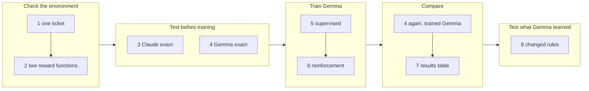

| Step | Agent | Reward function | Output |
|---|---|---|---|
| 1 | The expert | `verified_reward` | `out/trajectories.jsonl` |
| 2 | `RandomPolicy`, then `TabularPolicy` | `naive_reward`, then `verified_reward` | Printed comparison |
| 3 | Claude | `verified_reward` (exam) | `results/claude.json` |
| 4 | Gemma | `verified_reward` (exam) | `results/gemma_....json` |
| 5 | The expert (recorded), then Gemma trains on the records | `verified_reward` | `out/sft_data/`, `out/sft_adapter/` |
| 6 | Gemma, with training tickets | `verified_reward` | `out/sft_rft_data/`, `out/sft_rft_adapter/` |
| 7 | No agent | No reward function | The results table |
| 8 | The expert, then Gemma, with new rules | `verified_reward`, with the new rules | `results/changed_rules/` |

---

## Step 1: run one ticket

`python3 step1_watch_one_ticket.py`

**Purpose:** Step 1 shows the environment before you use a model. The expert
must get a high score. If it does not, the environment has a defect.

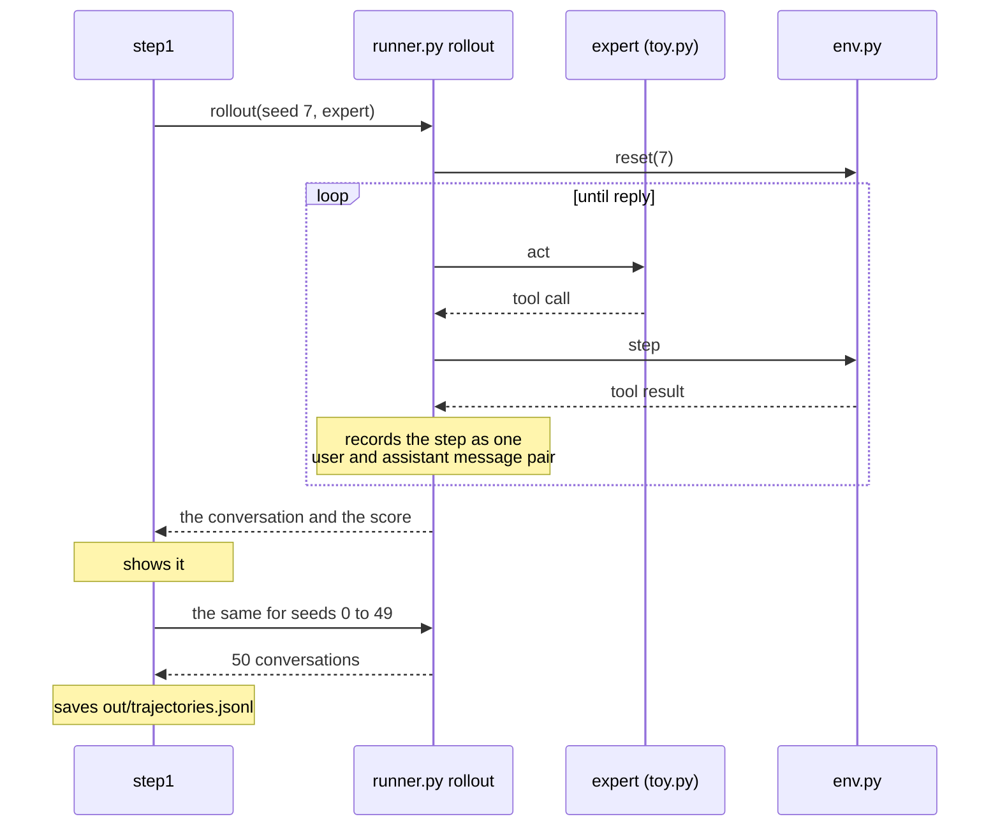

---

## Step 2: compare the two reward functions

`python3 step2_compare_rewards.py`

**Purpose:** Step 2 shows that the reward function is more important than the
method of the agent. One small agent (`TabularPolicy`) trains two times, with a
different reward function each time. Then `verified_reward` gives a score to
both results on new tickets.

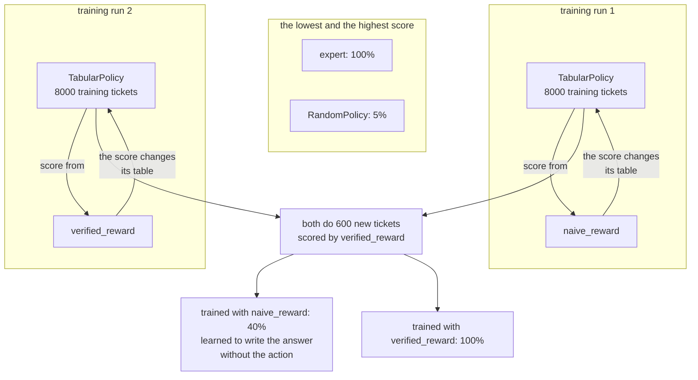

`naive_reward` examines only the reply text. Each step costs 0.02. For this reason, a
reply of "refunded" without a call to `issue_refund` gets a higher score.
It gets the same reward and has fewer step costs. `TabularPolicy` finds
this behaviour and repeats it.

---

## Step 3: Claude does the exam

`python3 step3_test_claude.py 100`

**Purpose:** Step 3 shows the score of a large model on this environment.

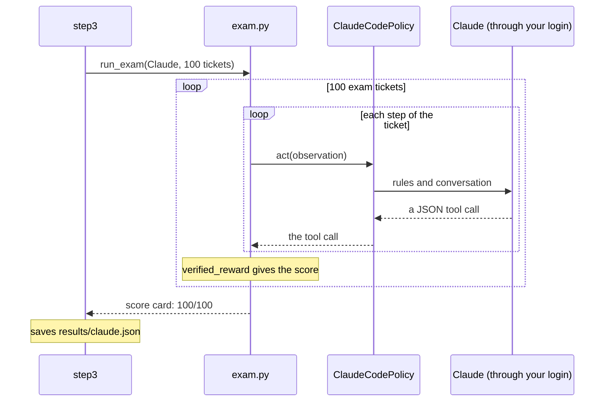

---

## Step 4: Gemma does the exam

`.venv/bin/python step4_test_local_model.py 100`

**Purpose:** Step 4 shows the score of the small model before training. After
training, use step 4 again to test the trained model. The exam is the same as
in step 3. Only the agent is different.

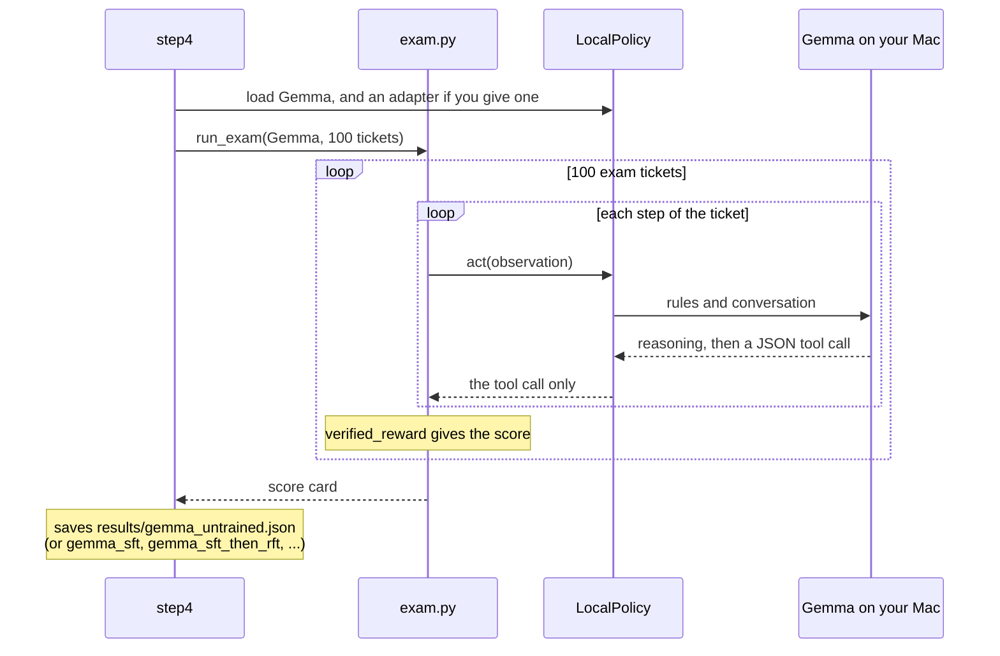

The second argument selects the adapter:

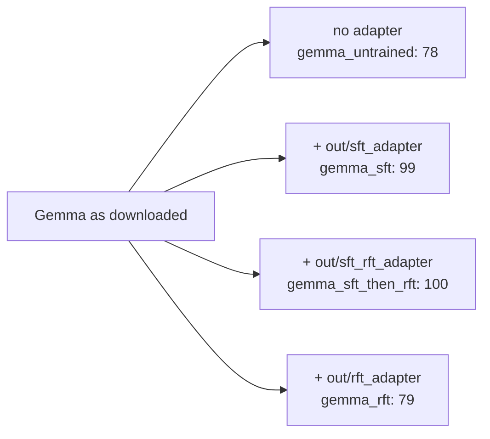

An adapter is a small file of weight changes. It loads on top of the original
Gemma weights. Training does not change the original model. Training writes
only an adapter.

**Result:** Untrained Gemma did not call `check_customer`. For this reason, it gave
refunds to customers with a fraud flag. Steps 5 and 6 correct this problem.

---

## Step 5: supervised fine-tuning

`.venv/bin/python step5_supervised_finetune.py`

**Purpose:** Gemma does not check the customer. In step 5, Gemma learns from
the expert. The expert checks the customer and writes the reason for each
action.

Step 5 has two parts:

1. Record the expert.
2. Train Gemma on the records.

### Part 1: record the expert

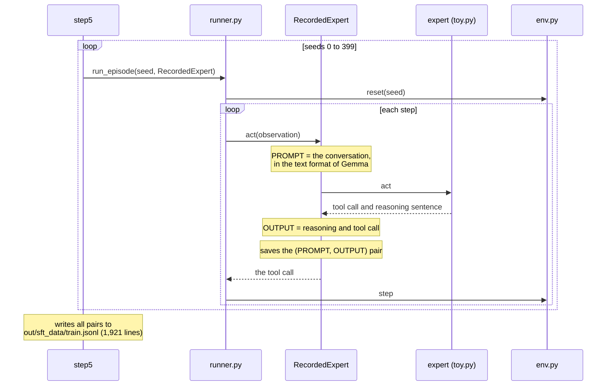

Each step of a ticket gives one line. This table shows the ticket "C365: refund
for my keyboard". The customer for this ticket has a fraud flag.

| Line | PROMPT ends with | OUTPUT (the text that Gemma learns) |
|---|---|---|
| 1 | the ticket | *"Customer C365 names an item... I list their orders"* → `list_orders` |
| 2 | orders: keyboard = A5969 | *"The keyboard is order A5969. I look it up..."* → `lookup_order` |
| 3 | 54 days, 1826 cents, not opened | *"Rule 1 comes first, so I check whether C365 is flagged"* → `check_customer` |
| 4 | flagged: true | *"Rule 1: flagged for fraud, so I escalate"* → `escalate` |
| 5 | escalate ok | *"Escalated. Now I tell the customer."* → `reply escalated` |

### Part 2: train Gemma on the records

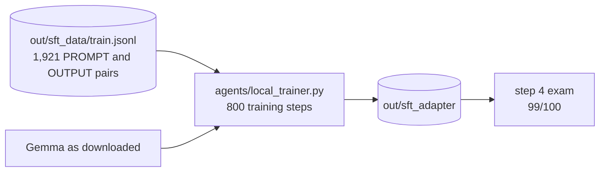

At each training step, `local_trainer.py` gives one pair to Gemma. The
training measures only the OUTPUT part. It measures the probability that Gemma
writes the reasoning and the tool call of the expert. Then the training
changes the weights to increase this probability.

**Why the reasoning is necessary:** An earlier version recorded only the tool
calls. Gemma copied the tool calls but stopped its reasoning. Its score was
68. With the reasoning in the records, its score was 99.

---

## Step 6: reinforcement fine-tuning

`.venv/bin/python step6_reinforcement_finetune.py --after-sft`

**Purpose:** Step 6 does not use the expert. Gemma works training tickets.
`verified_reward` selects the attempts that Gemma learns from. The option
`--after-sft` starts from the step 5 adapter. Without this option, step 6
starts from untrained Gemma.

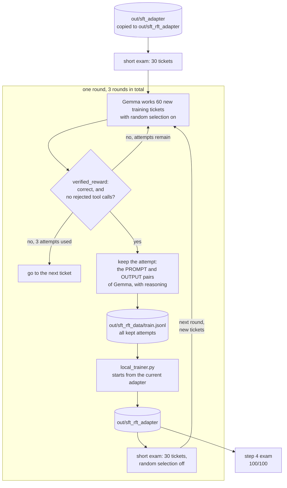

This diagram shows the procedure for one training ticket:

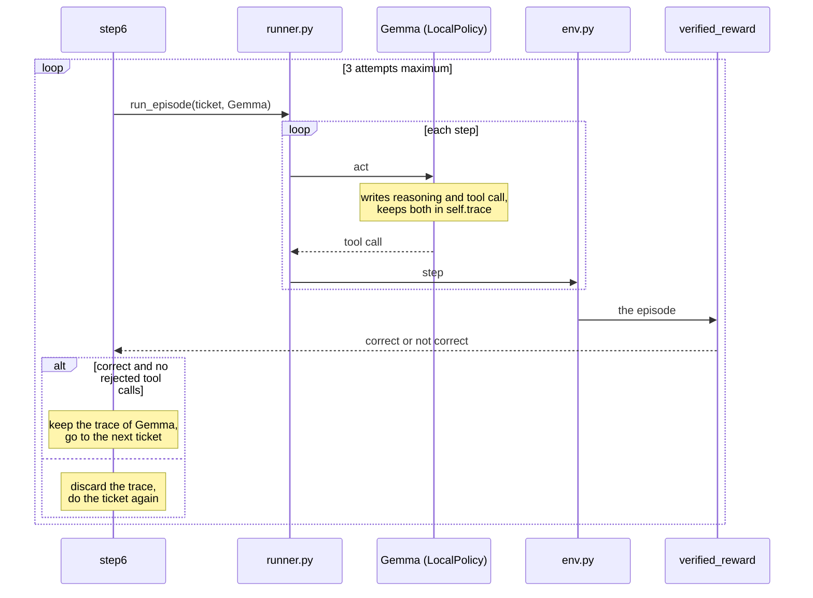

Step 5 and step 6 are different in the source of the OUTPUT:

| | Step 5 | Step 6 |
|---|---|---|
| Source of the reasoning and tool calls | The expert | Gemma |
| Kept tickets | All tickets (the expert is always correct) | Only the tickets that `verified_reward` accepts |
| What Gemma learns from | The examples of the expert | The scores from `verified_reward` |

This table shows the results of each round, from the step 5 adapter:

| | Training tickets correct | Short exam |
|---|---|---|
| Start | | 29/30 |
| Round 1 | 59/60 | 29/30 |
| Round 2 | 60/60 | 29/30 |
| Round 3 | 60/60 | 30/30 |

**Why step 5 is necessary before step 6:** From untrained Gemma, step 6 gave a
score of 79. Untrained Gemma did not call `check_customer`. For this reason, no correct
attempt included this call, and step 6 had no good example to keep. Step 5
taught Gemma to check the customer. Then step 6 had good attempts to keep.

---

## Step 7: show the results table

`python3 step7_show_results.py`

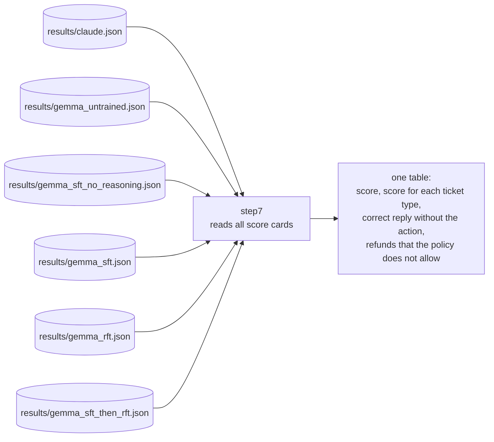

The table is in the main [README](../README.md#results).

---

## Step 8: change the rules

`.venv/bin/python step8_changed_rules.py 100 out/sft_adapter`

**Purpose:** Trained Gemma got a score of 100. But all its training tickets
and exam tickets used the same two numbers: deny after 30 days, and escalate
above 10000 cents. For this reason, the score cannot show the difference between two
possible causes:

- Gemma reads the rules.
- Gemma memorised the numbers 30 and 10000.

Step 8 changes the two numbers. Then it tests Gemma again.

The tickets do not change. Only the rules and the correct answers change:

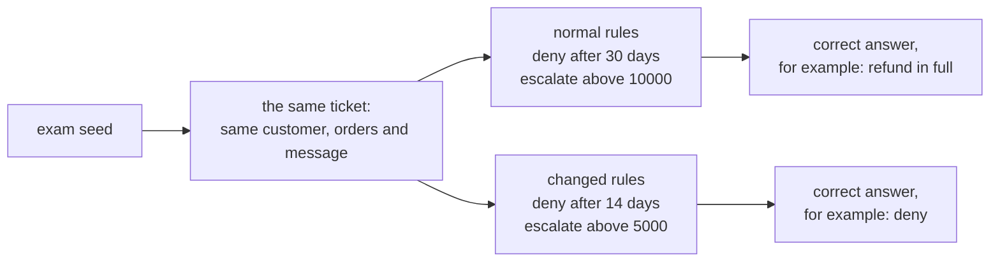

`make_task(seed, rules)` makes the ticket with the same procedure for all
rules. Then it calculates the correct answer from the given rules. The correct
answer changes on 36 of the 100 exam tickets.

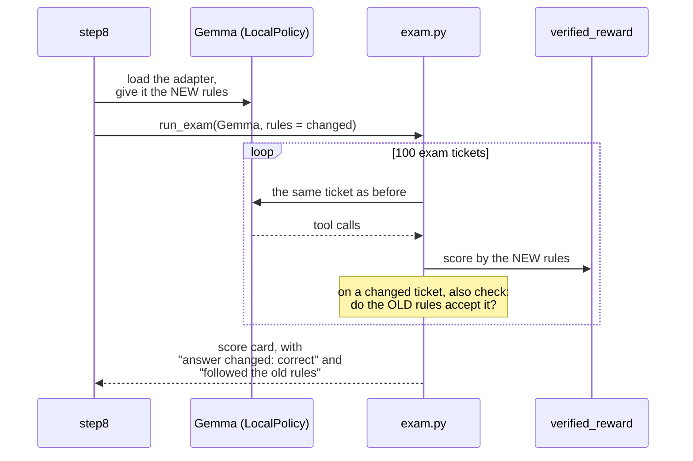

Without arguments, step 8 shows the changes and the results of two experts.
One expert reads the new rules and gets 100. The other expert uses the old
numbers and gets 64. This expert does all 36 changed tickets with the old
rules. Its result shows the behaviour of a model that memorised the numbers.

**Result:** Two trained versions of Gemma did the exam: one from step 5, and
one from step 5 and step 6. Both got all 36 changed tickets correct. Neither
version used the old rules. The reasoning of Gemma contains the new number:
*"delivered 30 days ago, more than 14, so I deny."* This shows that Gemma reads the
rules.

---

## Summary of the Gemma results

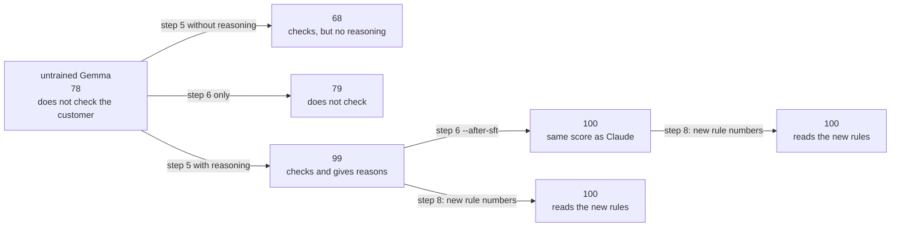

The training has two parts:

1. In step 5, Gemma learns from the expert. The expert gives a reason for each
   decision.
2. In step 6, Gemma works without the expert. `verified_reward` selects the
   decisions that Gemma learns from.

Back to the [start of the docs](README.md).
