# 3. The steps

Seven scripts, run in order. Each one puts a trainee at the desk for some
reason: to show the shop, to test, to record, or to train.

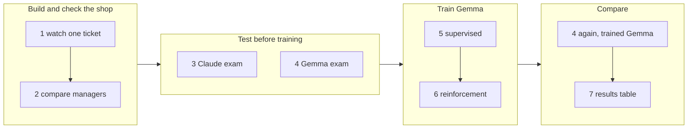

| Step | Who sits at the desk | Which manager | What comes out |
|---|---|---|---|
| 1 | The expert | careful | `out/trajectories.jsonl` |
| 2 | Random, then a tiny learner | lazy, then careful | Printed comparison |
| 3 | Claude | careful (exam) | `results/claude.json` |
| 4 | Gemma | careful (exam) | `results/gemma_....json` |
| 5 | The expert (recorded), then Gemma studies it | careful | `out/sft_data/`, `out/sft_adapter/` |
| 6 | Gemma, practising | careful | `out/sft_rft_data/`, `out/sft_rft_adapter/` |
| 7 | Nobody | none | The results table |

---

## Step 1: watch one ticket

`python3 step1_watch_one_ticket.py`

**Why:** to see the shop working before any AI is involved. If the expert
can't score well, the shop is broken, not the trainee.

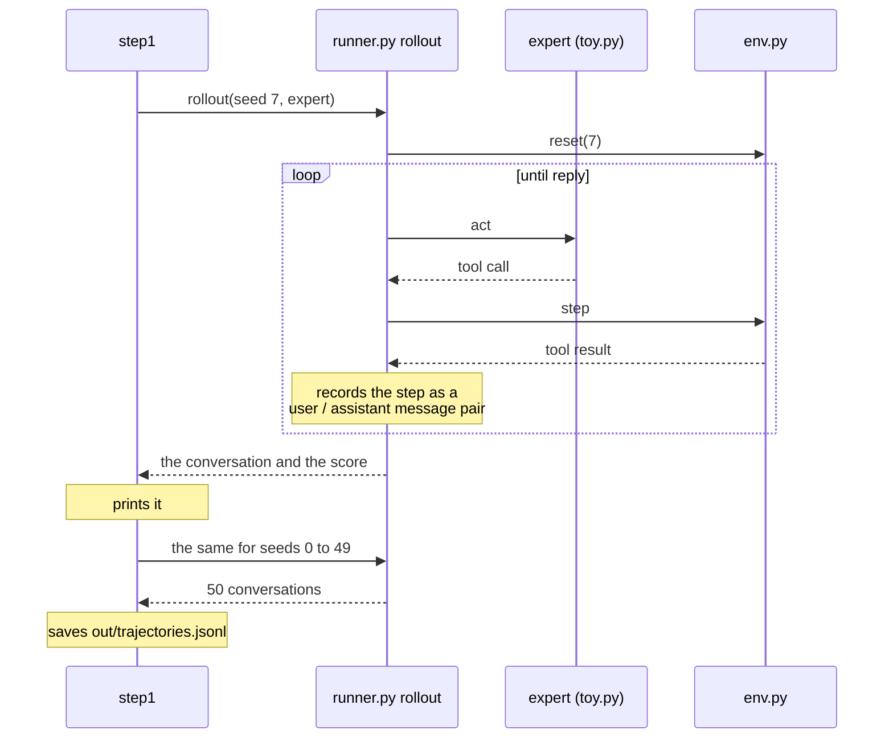

---

## Step 2: compare the two managers

`python3 step2_compare_rewards.py`

**Why:** to show the reward function matters more than the learner. The same
tiny learner is trained twice, once by each manager, then both are graded
fairly on unseen tickets.

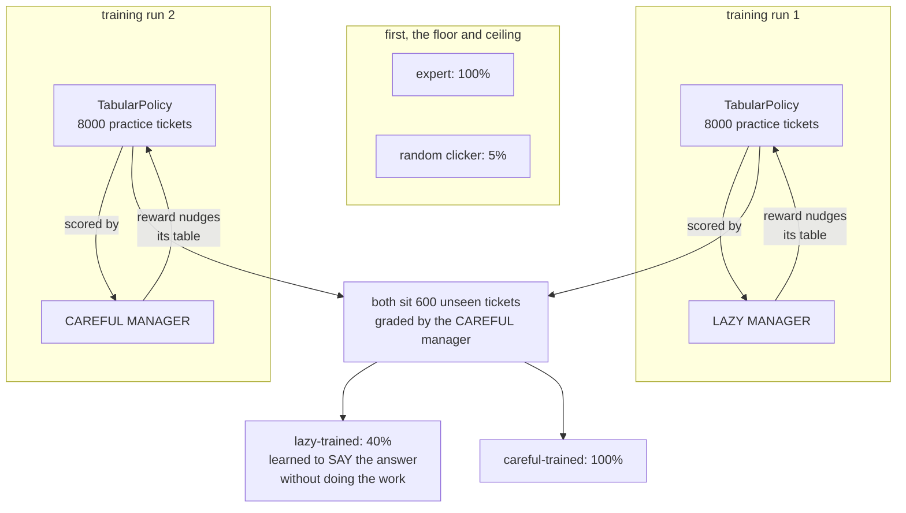

The lazy manager pays for words, and every step costs 0.02. So replying
"refunded" without issuing the refund, or "escalated" without pressing
escalate, is literally rewarded: same score, fewer steps. The learner finds
that and keeps doing it.

---

## Step 3: Claude sits the exam

`.venv/bin/python step3_test_claude.py 100`

**Why:** a strong model shows what a good score looks like on this shop.

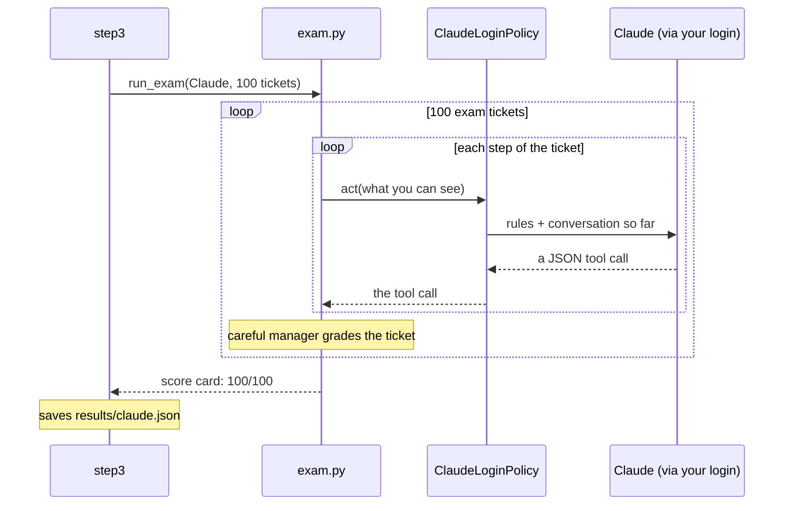

---

## Step 4: Gemma sits the exam

`.venv/bin/python step4_test_local_model.py 100`

**Why:** to see where the small model starts, and later to test it after
training. It's the same exam as step 3; only the trainee changes.

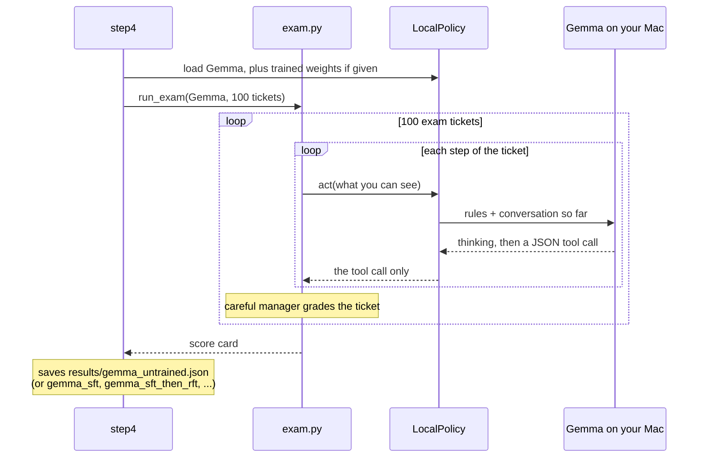

The second argument picks which weights to load:

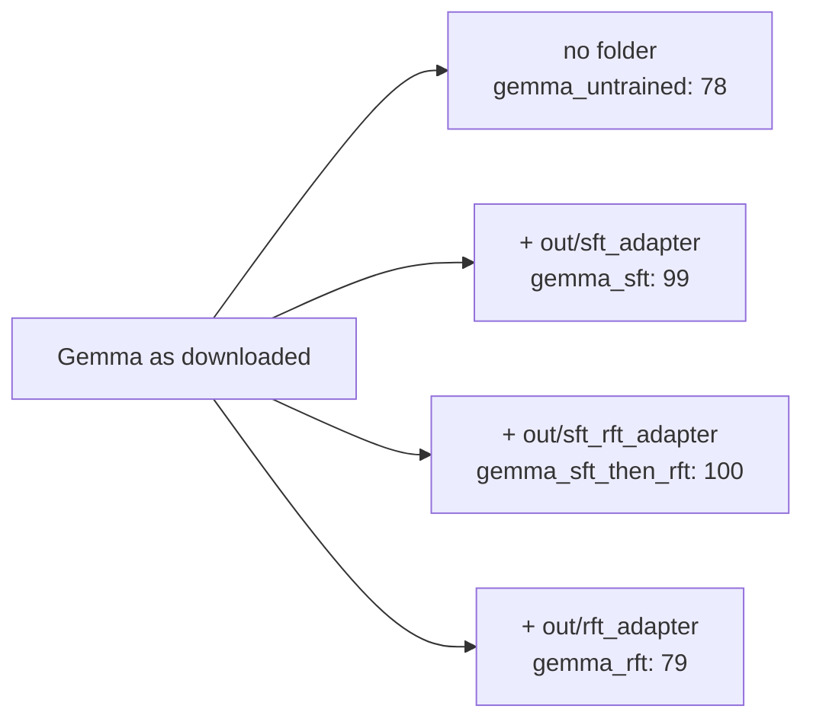

An adapter is a small file of changes laid on top of Gemma's original weights.
Training never changes the original model; it only writes an adapter.

**What the untrained exam showed:** Gemma never called `check_customer`, so it
refunded customers who were flagged for fraud. That's the problem steps 5 and 6
set out to fix.

---

## Step 5: supervised fine-tuning (learn from the expert)

`.venv/bin/python step5_supervised_finetune.py`

**Why:** Gemma never checks the customer, so we show it someone who does, and
who explains why.

Step 5 has two parts: **record** the expert, then **train** on the recording.

### Part 1: record the expert

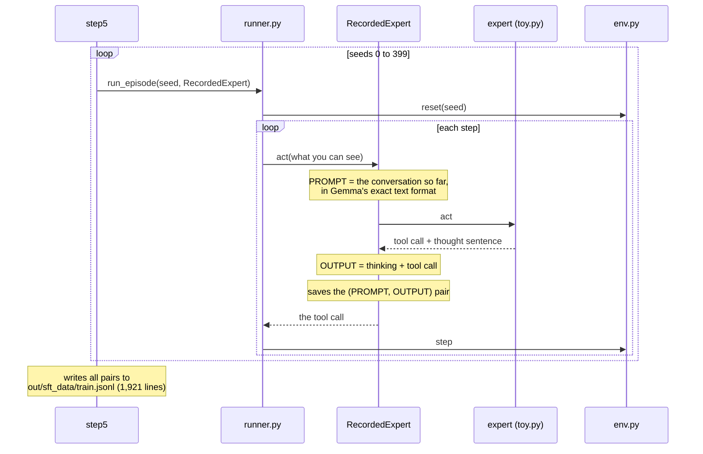

One ticket gives one line per step. For the ticket "C365: refund for my
keyboard", whose customer turns out to be flagged:

| Line | PROMPT ends with | OUTPUT (what Gemma learns to write) |
|---|---|---|
| 1 | the ticket | *"Customer C365 names an item... I list their orders"* → `list_orders` |
| 2 | orders: keyboard = A5969 | *"The keyboard is order A5969. I look it up..."* → `lookup_order` |
| 3 | 54 days, 1826 cents, not opened | *"Rule 1 comes first, so I check whether C365 is flagged"* → `check_customer` |
| 4 | flagged: true | *"Rule 1: flagged for fraud, so I escalate"* → `escalate` |
| 5 | escalate ok | *"Escalated. Now I tell the customer."* → `reply escalated` |

### Part 2: train on the recording

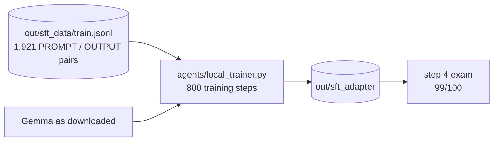

At each training step, `local_trainer.py` shows Gemma one pair. Gemma is graded
**only on the OUTPUT part**: how likely it was to write the expert's thinking
and tool call after that prompt. Its weights are nudged to make that more
likely next time.

**Why the reasoning matters:** an earlier version recorded only the tool calls.
Gemma copied the steps but stopped thinking, and scored 68. With the reasoning
included, it scored 99.

---

## Step 6: reinforcement fine-tuning (learn from its own good attempts)

`.venv/bin/python step6_reinforcement_finetune.py --after-sft`

**Why:** no expert this time. Gemma practises, and the careful manager decides
which attempts are worth learning from. `--after-sft` starts from step 5's
weights; without it, step 6 starts from untrained Gemma.

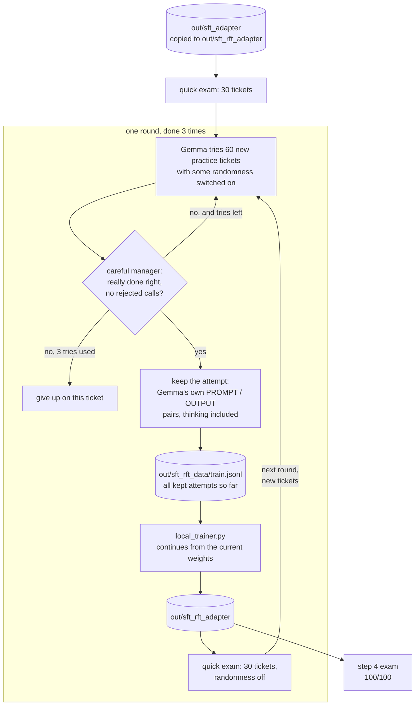

How one practice ticket is handled:

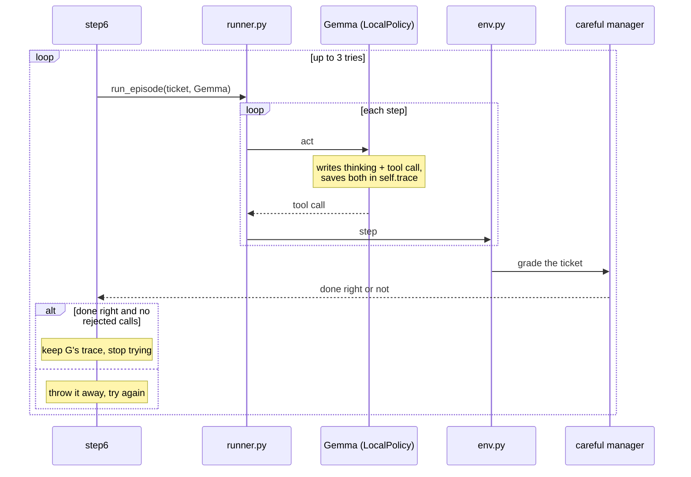

The difference from step 5 is **who wrote the OUTPUT**:

| | Step 5 | Step 6 |
|---|---|---|
| Who wrote the thinking and tool calls | The expert | Gemma itself |
| Which tickets are kept | All of them (the expert is always right) | Only the ones the careful manager approves |
| Teacher | The expert's examples | The manager's grades |

What the rounds showed, starting from step 5's weights:

| | Practice tickets solved | Quick exam |
|---|---|---|
| start | | 29/30 |
| round 1 | 59/60 | 29/30 |
| round 2 | 60/60 | 29/30 |
| round 3 | 60/60 | 30/30 |

**Why step 5 had to come first:** run from untrained Gemma, step 6 scored 79.
Untrained Gemma never checked the customer, so none of its successful attempts
included a check, and there was nothing good to keep. Step 5 put the check into
Gemma; step 6 then had good attempts to reinforce.

---

## Step 7: the results table

`python3 step7_show_results.py`

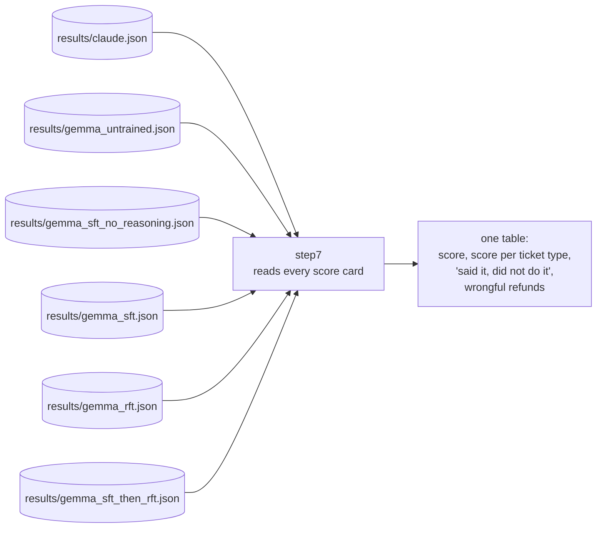

The table is in the main [README](../README.md#results).

---

## The whole journey of Gemma

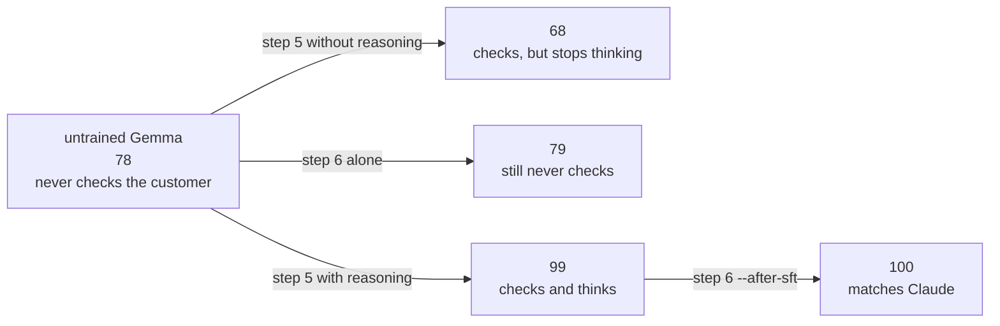

In shop terms: first the trainee shadows an expert who explains every decision
out loud (step 5). Then the trainee works the desk alone, and the manager's
grades tell it which of its own decisions to keep doing (step 6).

Back to the [start of the docs](README.md).
