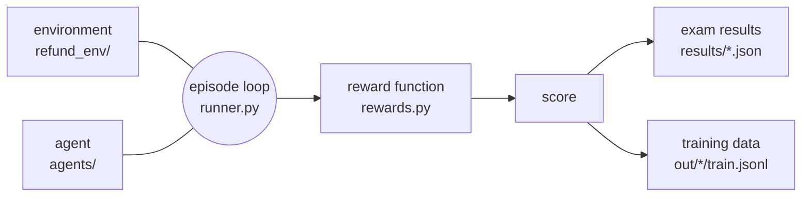

# How this project works

This project trains a language model to work customer refund tickets. The
model uses tools on a simulated order database. A reward function gives a
score to each ticket that the model completes.

Read these pages in this sequence:

1. [The environment](1-environment.md): the tickets, the tools, the reward
   functions and the exam.
2. [The agents](2-agents.md): the programs and models that work the tickets.
3. [The steps](3-steps.md): the eight scripts, with one diagram for each
   script.

## Terms

These pages use the terms in this table. Each term has one definition only.

| Term | Definition | Location | Shop word |
|---|---|---|---|
| Environment | The order database, the tools and the episode | `refund_env/env.py` | The shop |
| Prerequisites | The tasks and the answer key that the environment needs. This demo makes them with code | `refund_env/tasks.py`, `refund_env/policy.py` | |
| Ticket | One customer request for a refund | `make_task()` in `tasks.py` | |
| Episode | One ticket, from the first tool call to the end | `run_episode()` in `runner.py` | |
| Agent | A program or model that selects the tool calls | `agents/` | The trainee |
| Reward function | The function that gives a score to a completed episode | `refund_env/rewards.py` | The manager |
| `naive_reward` | A reward function that examines only the reply text | `rewards.py` | The lazy manager |
| `verified_reward` | A reward function that examines the database changes | `rewards.py` | The careful manager |
| Exam | The same 100 tickets for every agent, scored with `verified_reward` | `refund_env/exam.py` | Exam day |
| Training | A process that changes the model weights | steps 5 and 6 | |
| Reasoning | The sentence that gives the reason for one tool call | `self.thought` in `toy.py` | |
| Adapter | A small file of weight changes that loads on top of the original model | `out/*_adapter/` | |

## The parts and how they connect

The episode loop connects one agent to the environment. At the end of the
episode, the reward function gives a score. The project uses the score in two
ways:

- An exam records the score in `results/`.
- A training step uses the score to select training data.
