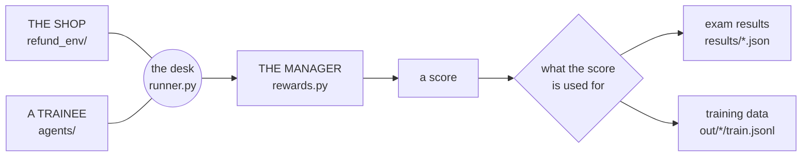

# How this project works

These pages explain the whole project with diagrams, from the shop itself to
the last results table. Read them in order:

1. [The shop](1-the-shop.md): what the environment is made of, what happens
   during one ticket, and how the managers grade it.
2. [The trainees](2-the-trainees.md): who can sit at the desk, why they all
   fit the same seat, and what job each one has.
3. [The steps](3-the-steps.md): what each of the seven scripts does, one
   diagram per step, including how the training data is made.

The project uses one picture throughout:

| Shop word | Project word | Where it lives |
|---|---|---|
| The shop | The environment | `refund_env/` |
| The trainee | The agent (or policy) | `agents/` |
| The manager | The reward function | `refund_env/rewards.py` |
| Exam day | Evaluation | `refund_env/exam.py` |
| Training | Fine-tuning | `step5`, `step6`, `agents/local_trainer.py` |

Everything in the project is one of these: building the shop, putting a
trainee at the desk, grading what it did, or using those grades to teach it.
